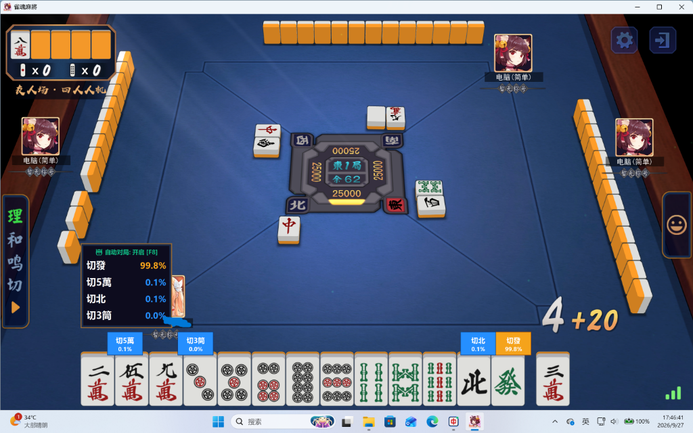
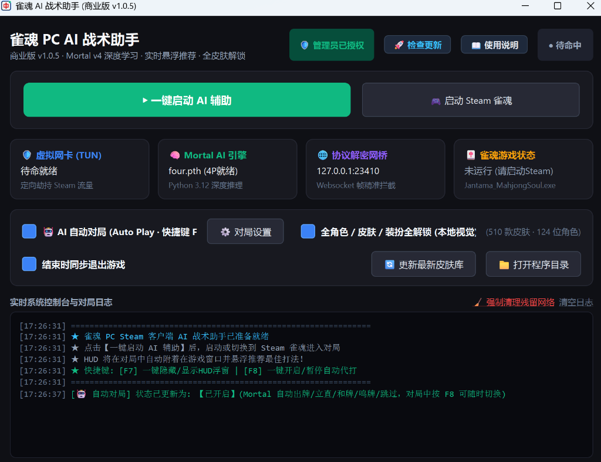
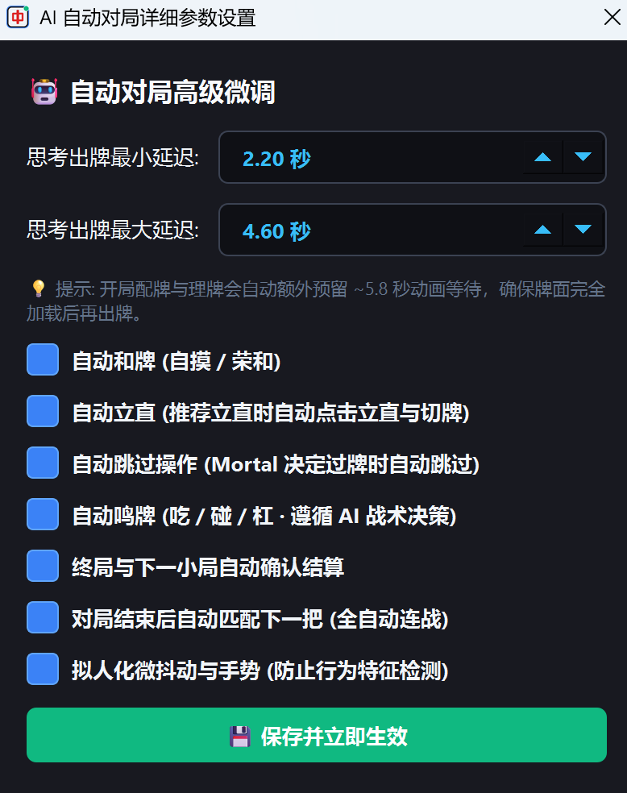

# 🀄 雀魂智囊助手 (Zizhi MahjongSoul Assistant) - 商业版

  
  
  
  
  

  <b>面向 Steam PC 雀魂端的高精度深度学习决策、全自动代打与智能战术辅助系统</b>
   
  <i>In-Memory Mortal AI Engine | Click-Through HUD Overlay | Linked Auto-Play & Rematch [F8] | Zero-Config TUN | Enterprise Anti-Reverse</i>

---

## 📸 软件实际界面展示 (Screenshots)

### 1. 战术 HUD 实战对局悬浮推荐
> 悬浮窗自适应附着于 Steam 游戏窗口，透明置顶、点击穿透，实时高亮最优打法概率与各张手牌期望得点！支持状态胶囊徽标实时显示 `[F8]` 自动代打与连战挂机状态。

  

---

### 2. 现代深色控制面板
> 一键拉起环境分流、AI 推理引擎与游戏进程监控，运行状态一目了然；支持全角色全皮肤本地视觉解锁、秒级热更新。

  

---

### 3. 拟人化智能代打微调设置
> 支持出牌最小/最大随机思考延迟、战术拟人降重模式、和牌/立直/鸣牌自主策略微调，以及连战功能与 `[F8]` 热键无缝联动。

  

---

## 🌟 核心功能特性

| 功能模块 | 说明 |
| :--- | :--- |
| 🧠 **Mortal 深度学习神经网络** | 内嵌 4P / 3P 双模型权重，对当前牌效、向听数、危险度与终局期望得点进行万级参数深度推理。 |
| 🖥️ **无缝透明战术 HUD** | 随游戏窗口无感缩放与移动，完美融入原版游戏界面，对局中按 **`[F7]`** 键可一键瞬间隐藏/呼出。 |
| 🤖 **拟人化自适应代打 & 连战联动 [F8]** | 支持自定义思考延迟与拟人微抖动。**连战排队与 `[F8]` 热键深度联动**：对局中按 `[F8]` 开启代打时同步启动连战，按 `[F8]` 暂停代打时立即终止连战排队，杜绝误排！ |
| 🎯 **战术拟人降重模式** | 独家研发防封机制！面对非关键次要切牌局面按设定概率选用次优解，有效降低 AI 吻合度指纹；关键和牌、立直与安牌防守绝对锁定最优解。 |
| 👗 **全角色/皮肤/装扮全解锁 (Skin Mod)** | 510 款皮肤 & 124 位角色全装扮本地 100% 视觉解锁，支持一键联网拉取最新皮肤数据库，局间永久持久化生效。 |
| 🌐 **底层网络虚拟网卡 (TUN)** | 基于 Sing-box 定向分流技术，精准拦截 Steam 游戏流量，无需配置代理端口或导入根证书，随开随走无残留。 |
| 🛡️ **企业级内核加固体系** | 纯 C 级底层看门狗、反 Inline Hook 特征检测、动态通道重排分片加密、Ed25519 签名清单验证与硬件级 `__fastfail` 自毁防御。 |
| 🔄 **云端静默自更新** | 客户端内置版本热更新服务，检测到新特性或算法优化时一键平滑升级，永久保持最新战力。 |

---

## 🚀 极简使用教程

### 第一步：下载软件包
前往本仓库右侧的 [**Releases**](https://github.com/Sleep312/Zizhi-MahjongSoul-Assistant/releases) 页面，下载最新发布的 `雀魂智囊助手_商业版_v1.3.5.zip`。

### 第二步：解压与运行
1. 将下载的 ZIP 压缩包解压到任意文件夹（建议路径不含中文或特殊符号）。
2. 鼠标双击打开 `雀魂智囊助手_商业版.exe`（软件会自动申请管理员权限以创建虚拟网络分流接口）。

### 第三步：输入卡密激活
1. 首次打开会弹出授权激活对话框。
2. 粘贴您获取到的**商业授权卡密**，点击【立即激活绑定】（一机一码自动绑定硬件）。

### 第四步：畅享对局
1. 在主界面点击绿色大按钮 **【▶ 一键启动 AI 辅助】**。
2. 打开 Steam 客户端启动《雀魂麻将》，进入任意段位战、比赛或人机友人房。
3. 发牌后，战术 HUD 将全自动出现在手牌上方提供实时胜率与切牌指引！
4. 对局中按下键盘 **`[F8]`** 即可随时一键开启/暂停全自动代打与排队连战。

---

## 💬 获取正版卡密 & 售后咨询

- ✈️ **Telegram 官方联系**：[https://t.me/xrw_my](https://t.me/xrw_my)  
  *(点击链接或在 Telegram 搜索 `@xrw_my` 咨询购买商业授权、定制功能或反馈技术问题)*

---

## ⚠️ 常见问题排查 (FAQ)

- **Q: 为什么提示需要管理员权限启动？**  
  A: 软件底层采用工业级 TUN 虚拟网卡协议定向截取 Steam 数据包，需要 Windows 管理员权限创建本地网络路由，属于正常操作。
- **Q: 杀毒软件（如 360 / Windows Defender）误报怎么办？**  
  A: 本软件对深度学习模型与二进制字节码进行了全原生 Cython 编译加固与内存分片加密，某些安全软件因无法逆向识别结构可能产生误报。请将解压目录加入白名单或信任区即可放心运行。
- **Q: 连战功能怎么控制？**  
  A: 在【⚙️ 对局设置】中勾选连战后，连战将直接受 **`[F8]` 热键**统一控制：按 `[F8]` 开启代打时自动连战，按 `[F8]` 暂停代打时立即停止排队下一把，防止人离开后电脑误打。
- **Q: 更换电脑或重装系统后卡密还能用吗？**  
  A: 卡密为一机一码硬件绑定。如遇更换电脑硬件或设备损坏，请直接联系作者 Telegram ([@xrw_my](https://t.me/xrw_my)) 申请重置解绑。

---

## ⚖️ 免责声明
本软件为开源麻将博弈算法学习与人机对战复盘研究工具。技术本身中立，请使用者自觉遵守所在游戏平台的用户协议与社区准则，切勿用于任何非法牟利场景。
